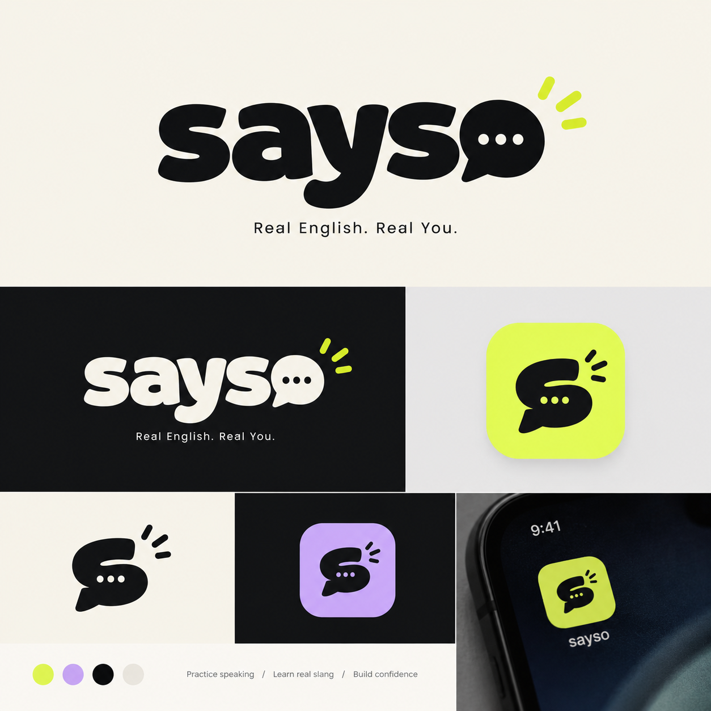

<div align="center">



# Say So

**Learn to actually *speak* English — out loud.**

A cozy virtual classroom where a patient, bilingual AI teacher listens to your voice,
corrects you without making you cringe, and drills the exact sounds your native
language keeps getting wrong.

[](https://nextjs.org)
[](https://react.dev)
[](https://www.typescriptlang.org)
[](https://tailwindcss.com)
[](https://supabase.com)
[](https://vitest.dev)

[Quick start](#-quick-start) · [Features](#-features) · [How it works](#-how-it-works) · [Roadmap](#-roadmap)

</div>

---

## Why Say So

Most apps teach you to *read* a language. **Say So** is built around the moment that
actually matters: opening your mouth. You speak, the AI teacher hears you, and it walks
you back from pronunciation to grammar — tuned to the specific mistakes speakers of
**Bahasa Indonesia, Español, and Português (BR)** tend to make.

> Example: an Indonesian learner says *"ship"* when they meant *"sheep"*. Say So hears it,
> shows the mouth shape, explains the long-`/iː/` vs short-`/ɪ/` contrast, and makes you
> try again until the score goes up.

## ✨ Features

| | Feature | What it does |
|---|---|---|
| 🎙️ | **Talk, don't type** | Push-to-talk voice input (Whisper / `gpt-4o-mini-transcribe`) and natural TTS voice output. |
| 🧠 | **Spoonfed AI teacher** | Every lesson follows a guided loop — HOOK → EXPLAIN → SHOW → PRACTICE → CORRECT → REINFORCE → REWARD — graded to your CEFR level (A1 → C2). |
| 🌍 | **Truly multilingual** | Onboarding, UI and narration in **Indonesian / Spanish / Portuguese**, each with its own interference coaching. |
| 🔊 | **Phonics lab** | All 26 letter sounds with **animated articulation diagrams** — moving jaw, tongue, airflow and vocal-cord vibration. |
| 🎯 | **Dialect Lens** | Plays a word "through your native ears" and shows the precise fix. |
| 📝 | **CEFR placement test** | Adaptive 12-question test with a downloadable, shareable result card. |
| 🗂️ | **Mistake Bank** | Every error is captured and turned into a personal drill. |
| 🚀 | **Progress engine** | XP, levels and streaks synced to Supabase. |
| 🎨 | **Doodle classroom** | Pastel, hand-drawn look with a 3D classroom scene (react-three-fiber). |

## 🏗 How it works

```
                    ┌──────────────────────────────────────────────┐
   voice  ─────────▶│  /api/transcribe   (STT: Whisper family)      │
                    └──────────────────────────────────────────────┘
                                     │ transcript
                                     ▼
┌──────────┐   text / voice   ┌──────────────────┐   system prompt + CEFR  ┌───────────────┐
│  Learner │ ───────────────▶ │  /api/chat        │ ──────────────────────▶ │  OpenAI-compat │
│  (browser│ ◀─────────────── │  streaming SSE    │ ◀────────────────────── │  chat provider │
│    mic)  │   streamed text  └──────────────────┘      token stream        └───────────────┘
└──────────┘                             │
     ▲                                   ▼
     │  spoken reply          ┌──────────────────────┐
     └─────────────────────── │  /api/tts  (teacher)   │
                              └──────────────────────┘

   progress ──▶ /api/progress ──▶ Supabase  `english` schema
```

- **Teacher brain** lives in `app/api/chat/route.ts` — it injects the learner's name,
  CEFR level, native-language interference rules, and current unit into a teaching prompt.
- **Providers are swappable**: chat, STT and TTS each read a `*_BASE_URL` / `*_API_KEY`
  pair, so you can point them at OpenAI or any OpenAI-compatible endpoint.
- **Progress** is written through `lib/supabase/admin.ts` into a dedicated `english`
  schema, so it never mixes with other data in the project.

## 🧰 Tech stack

- **Framework** — Next.js 16 (App Router) · React 19 · TypeScript
- **Styling** — Tailwind CSS v4 (`@theme` in `app/globals.css`) · framer-motion · tw-animate-css
- **3D / character** — three.js · @react-three/fiber · @react-three/drei
- **State & data** — zustand · @tanstack/react-query · @supabase/ssr
- **Audio** — Web Speech API + Whisper transcription, wavesurfer.js
- **Tooling** — Vitest · ESLint · shadcn/base-ui

## 🚀 Quick start

```bash
# 1. install
npm install

# 2. configure your own keys
cp .env.example .env.local        # Windows: copy .env.example .env.local
# ...then edit .env.local and fill in your Supabase + AI provider keys

# 3. run
npm run dev                       # http://localhost:3000
```

> **Never commit `.env.local`.** It is git-ignored. Commit only `.env.example`.
> The app degrades gracefully when AI/Supabase keys are missing, so you can boot the UI first.

### Supabase setup (optional, for saved progress)

1. Run `supabase/migrations/001_schema.sql` and `002_progress.sql` in the SQL editor.
2. Project Settings → API → **Exposed schemas** → add `english`.
3. Put the project URL + anon key + service-role key into `.env.local`.

Auth users are shared with the host project; learning data stays isolated in the `english` schema.

## 📜 Scripts

| Script | Description |
|---|---|
| `npm run dev` | Start the dev server |
| `npm run build` / `npm start` | Production build & serve |
| `npm run lint` | ESLint |
| `npm test` | Vitest unit tests (placement engine, g2p, interference) |
| `npm run gen:lexicon` | Regenerate the IPA lexicon from the CMU dictionary |
| `npm run gen:tts` | Pre-render the onboarding narration clips |

## 📁 Project structure

```
app/
  api/{chat,transcribe,tts,progress}/   # server routes (AI proxies + progress)
  onboarding/ karakter/ placement/      # setup flows
  room/                                 # the 3D classroom (main experience)
  mulai/                                # phonics warm-up
components/
  three/                                # classroom scene + procedural characters
  room/                                 # whiteboard, IPA board, dialect lens, mistake bank
  phonics/ placement/ character/        # UI building blocks
lib/
  i18n/                                 # id / es / pt bundles
  phonetics/ phonics/                   # g2p, visemes, interference rules
  placement/ curriculum/ cefr/          # CEFR engine + content
  supabase/ store/ progress/            # data + state
supabase/migrations/                    # database schema
```

## 🗺 Roadmap

- [x] Virtual classroom with a streaming bilingual AI teacher
- [x] Voice in/out, phonics lab, Dialect Lens, CEFR placement test
- [ ] Flashcard + SRS (FSRS)
- [ ] Writing Coach
- [ ] Roleplay simulations
- [ ] Progression engine: streak, capstone, certificates

## 🏆 Built for the hackathon

Say So is a working, tested prototype — 3D classroom, live voice loop, three languages,
and real phonetics coaching. Demo it in a browser with a mic, no install.

**Author** — Muhammad Kafi Rizki ([@kapihimself](https://github.com/kapihimself))

## 📄 License

Released under the [MIT License](./LICENSE).
